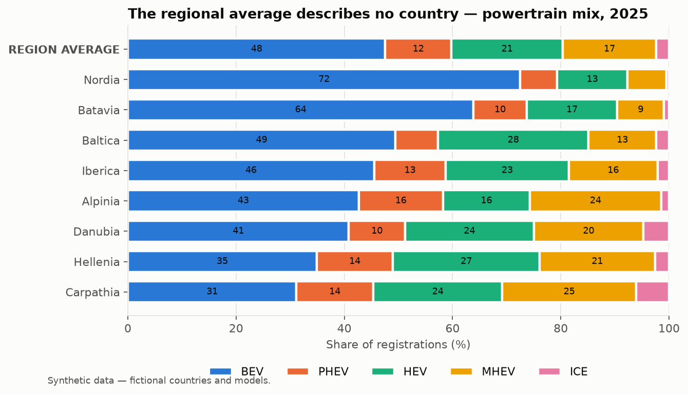
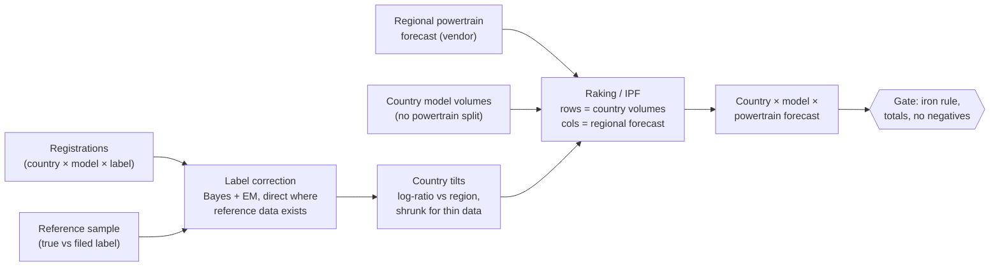
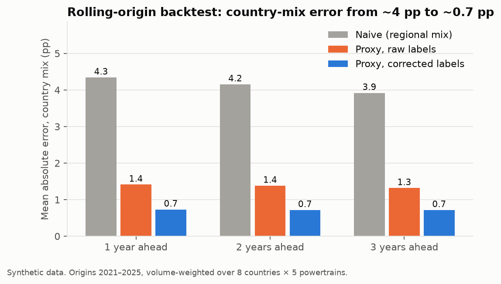
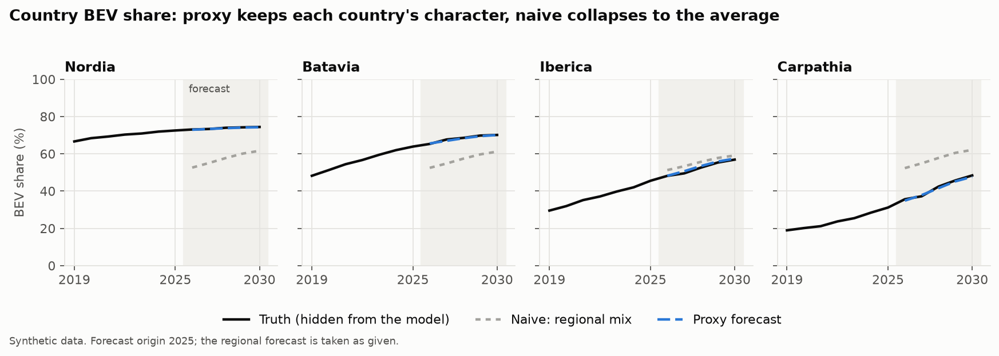
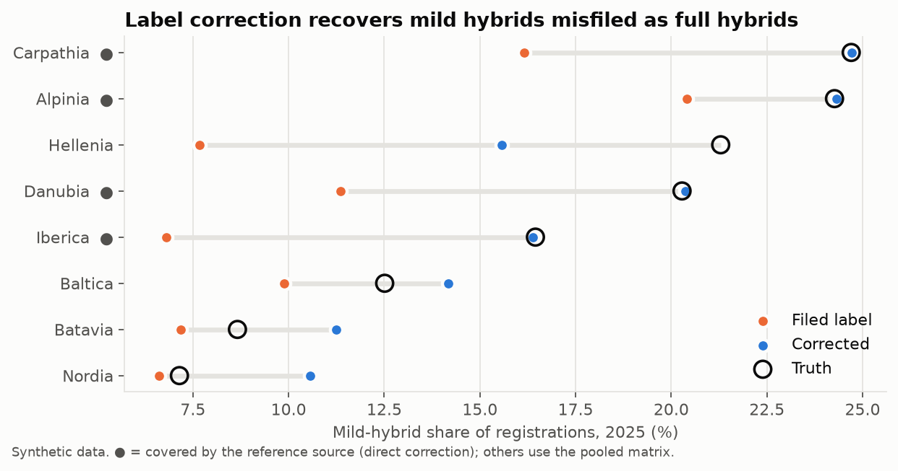
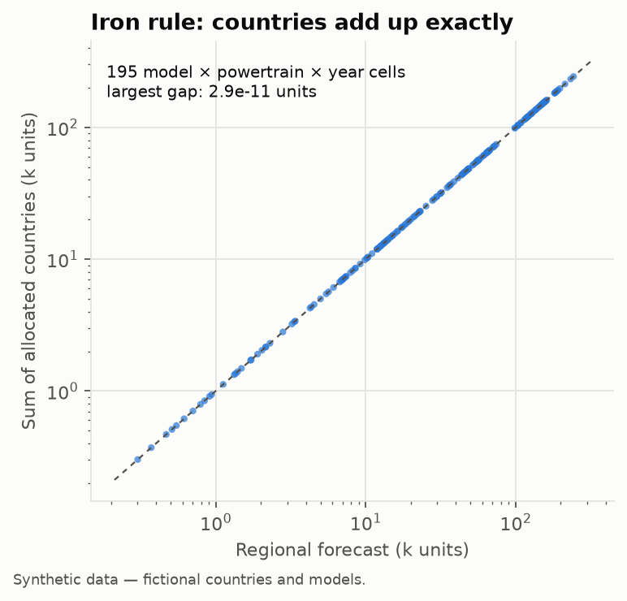

# Powertrain Mix Forecaster — country-level EV forecasts for markets nobody forecasts

[](https://github.com/PandasAndChill/forecast-showcase/actions/workflows/ci.yml)


> Public showcase of a forecasting tool I designed and built for the market-intelligence team of a
> European car maker. The production tool runs on licensed data that cannot leave the company; this
> repository reproduces **the method, the code structure and the validation** on a synthetic market,
> so every number and chart below can be regenerated with one command.

| | |
|---|---|
| **Problem** | Vendors forecast the BEV / PHEV / HEV / MHEV / ICE mix for the big markets and for the smaller ones only *as one block*. Planning needs each country. |
| **Solution** | Split the block forecast into countries using each country's own registration behaviour — while guaranteeing the countries add back up to the vendor forecast *exactly*. Clean mislabelled registrations first. |
| **Result** | On a rolling backtest, country-mix error falls from **~4 pp** (copy the regional average) to **~0.7 pp**, 1–3 years ahead. The tool now runs as a stage of the team's forecast build. |

---

## 1. The business problem

The regional block hides very different markets. Copying its average onto each country — the
default when no better data exists — is wrong for every one of them:



Two constraints shape the solution:

- **The vendor forecast is the reference.** Whatever the split, countries must sum back to it for
  every model, powertrain and year. Anything else breaks reconciliation with the rest of the
  forecast and loses the business's trust instantly.
- **Registration data lies a little.** Feeds misfile neighbouring technologies (mild hybrids filed
  as full hybrids is the classic), and the error rate differs by country.

## 2. Approach



1. **Correct the labels** — a cleaner reference source gives `P(filed label | true powertrain)`.
   Covered countries use their own matrix, others the pooled one. Bayes' rule, with a prior
   re-estimated by EM on each country's own data, moves misfiled volume back. Volume is conserved.
2. **Measure each country's character** — the log-ratio of its mix to the regional mix, per model,
   shrunk toward the country's overall tilt when the model is thin in that market.
3. **Allocate with a hard constraint** — seed = regional mix × country tilt, then rake (iterative
   proportional fitting) until rows match country volumes and columns match the regional forecast.
   Single-powertrain models are exact by construction.

Details and design choices: [docs/METHODOLOGY.md](docs/METHODOLOGY.md).

## 3. Results (synthetic market)

**Backtest.** From each origin 2021–2025, tilts are fitted on the three preceding years only, then
scored 1–3 years ahead against the hidden truth:



The proxy keeps each country's trajectory where the naive split collapses everything to the average:



Label correction works best where the reference source covers the country (●). Elsewhere the
pooled matrix is a reasonable but imperfect guess — over-correcting clean feeds and
under-correcting the worst one — which is why widening reference coverage is the next step:



And the constraint the business cares about most holds to floating-point precision:



## 4. From analysis to a production tool

The proxy is one stage of a larger forecasting pipeline I built and maintain. What runs in
production (described here, not included — it is tied to licensed data):

| Area | What it looks like |
|---|---|
| **Pipeline** | 11-stage reproducible build: ingestion adapters per source → validation → canonical long-form model → forecast → reconciliation → the proxy stage → Excel/report outputs with a revision report. One command to refresh on a new data release. |
| **Quality gates** | Every run checks the iron rule, country and regional totals, negative volumes and release consistency, and stops the build on failure. |
| **Testing** | ~900 automated tests on synthetic fixtures; a rolling-origin backtest re-run on each methodology change. |
| **Engineering hygiene** | Private GitHub repo with CI (lint, tests, data-leak guards), pre-commit and pre-push hooks that block proprietary files, configuration-driven paths, Architecture Decision Records for every method change. |
| **Confidentiality by design** | Code and documentation are versioned; data, mappings and outputs never are. This public repo is a direct product of that separation. |

## 5. How it was built — iteratively

The method was not designed upfront; each version shipped, was measured, and the measurement drove
the next step.

| Iteration | What changed | Why |
|---|---|---|
| v0 | Regional mix copied to every country | Baseline: the default when no country detail exists. |
| v1 | Country tilts + raking with the iron rule | Countries differ a lot; the vendor total must hold. |
| v2 | Label correction (direct + Bayes) | Backtest residuals traced to misfiled mild hybrids. |
| v3 | Tilts persist beyond the vendor horizon | Long-range extension was snapping countries back to the average. |
| v4 | Integrated as a pipeline stage with gates and a refresh script | From analysis to something the team runs every release. |
| v5 *(in progress)* | Review loop with the market experts | Edge cases (tiny markets, new variants) belong to people who know them. |

This showcase followed the same loop. The first synthetic test showed label correction making
things *worse*: misfiling was identical in every country, so raking absorbed it, and the regional
prior pulled countries toward the average. I made misfiling country-specific (as it is in reality)
and switched to an EM-updated prior — the result above. See [docs/DELIVERY.md](docs/DELIVERY.md).

## 6. Run it yourself

```bash
git clone https://github.com/PandasAndChill/forecast-showcase && cd forecast-showcase
pip install -e ".[dev]"
python scripts/make_figures.py   # regenerates assets/ and assets/backtest.csv (~10 s)
pytest -q                        # business-rule tests
```

```text
src/ptproxy/
  allocate.py    country tilts + raking under the iron rule
  labels.py      confusion matrices, Bayes/EM relabelling (vectorised)
  synthetic.py   fictional 8-country region, 14 models, 2019–2030
  backtest.py    rolling-origin evaluation, three methods
scripts/make_figures.py
tests/test_proxy.py
docs/            methodology, delivery log
```

## 7. What is not here

No real data, vendor names, mappings, forecasts or production code. Countries (Nordia, Iberica, …)
and models are fictional; the synthetic market is built to reproduce the *structure* of the real
problem (strong country preferences, country-specific misfiling, partial reference coverage), not
its numbers.

---

**Petr Shovoldaev** — Lead Consumer & Market Analyst, Paris. Market intelligence × Python
automation: I build the tools my analyses run on.
